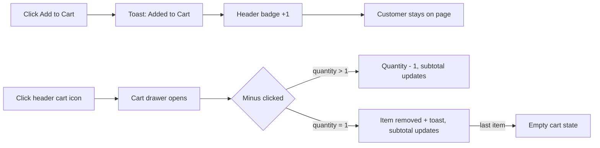

# Issue #7: Fix Add to Cart and Quantity Decrement Behaviour

| | |
|---|---|
| GitHub Issue | [#7](https://github.com/i-c-c-c/QuantumTech__V1/issues/7) |
| Assignee | Tahsan Mohammad (Cart, Checkout, Payment & QA) |
| Supporting developer | Sakib |
| Branch | `tahsan/issue-7-cart-behaviour` |
| Status | Fixed and tested; ready for a pull request into `main` |

---

## 1. Problem (from the issue)

1. Every click on **Add to Cart** opened the cart drawer automatically, interrupting shopping.
2. The **minus** button could not reduce quantity below 1; users had to use the bin icon.

Required: keep shopping after adding, a working minus button, removal when quantity goes below 1,
and automatic updates of cart count and subtotal, on desktop and mobile.

## 2. Root cause

| Symptom | Cause |
|---|---|
| Drawer opens on every add | `src/context/CartContext.tsx` called `setIsCartOpen(true)` at the end of `addToCart()`, used by the product page, product cards and the promotional popup. |
| Minus stuck at 1 | `src/components/QuantitySelector.tsx` defaults to `min = 1` and disables the minus button at `quantity <= min`. The cart drawer and cart page used the default. |

## 3. What changed

| File | Change |
|---|---|
| `src/context/CartContext.tsx` | Removed the automatic `setIsCartOpen(true)` after adding. The existing "Added to Cart" toast and the header cart badge confirm the add. `updateQuantity()` now calls `removeFromCart()` when the new quantity is below 1, so removal shows the same "Item removed" toast as the bin icon. |
| `src/components/CartDrawer.tsx` | Quantity stepper uses `min={0}`: minus at 1 removes the item. |
| `src/pages/CartPage.tsx` | Same as the drawer: `min={0}`. |
| `src/components/QuantitySelector.tsx` | When the next minus click would remove the item, the button's `aria-label`/tooltip reads **"Remove item"** (accessibility). Added `data-testid="qty-decrease"` / `qty-increase` for automated tests. Default `min` is still `1`. |
| `scripts/test-cart-behaviour.mjs` | **New** automated regression test for this issue (desktop 1366px and mobile 375px). |
| `package.json` | New script `npm run test:cart`; also added to `npm test`. |
| `README.md` | Feature list and test commands updated. |

Unchanged on purpose:

* The **product page** quantity picker still stops at 1; you can't add 0 items.
* The cart drawer still opens from the **header cart icon** as before.
* Cart count and subtotal were already derived from the cart items, so they update instantly after
  every add, plus, minus or remove. The tests confirm this.

## 4. Behaviour after the fix



## 5. How to test

### Automated

```bash
npm install
npm run dev            # terminal 1, serves http://localhost:3000
npm run test:cart      # terminal 2
```

If Puppeteer's own Chrome isn't downloaded yet, point it to the installed Chrome:

```bash
# Git Bash
PUPPETEER_EXECUTABLE_PATH="C:\Program Files\Google\Chrome\Application\chrome.exe" npm run test:cart
# PowerShell
$env:PUPPETEER_EXECUTABLE_PATH="C:\Program Files\Google\Chrome\Application\chrome.exe"; npm run test:cart
```

The test runs at desktop (1366px) and mobile (375px) widths and checks:

1. Add to Cart on the product page and on a product card does **not** open the drawer, and the
   customer stays on the page.
2. The header badge shows the new count.
3. The drawer opens from the cart icon; plus and minus change quantity; subtotal and badge update.
4. Minus at quantity 1 is labelled "Remove item", removes the line and shows the "Item removed" toast.
5. On the cart page, minus removes items until the cart is empty; the badge shows 0 and the drawer
   shows the empty state.
6. The product page quantity picker cannot go below 1.

**Results on 24 Nov 2026:**

| Check | Result |
|---|---|
| `npm run test:cart` with the fix | ✓ all checks passed (desktop + mobile) |
| `npm run test:cart` against the **old** code | ✗ fails: drawer opens, minus disabled at 1, item not removed. The test catches the bug. |
| `npm run build` (TypeScript + Vite) | ✓ success |
| `npm test` (full existing suite) | ✓ customer flow, cart, admin, orders/payments, bilingual 29/29, promotions 42/42, stock sync 31/31. The last script, `verify-hero-customization.mjs`, fails for an unrelated pre-existing reason (QA-01 below). |

### Manual checklist (desktop and phone)

- [ ] Product page → Add to Cart: toast appears, drawer stays closed, badge +1
- [ ] Shop / Home → product card cart button: same as above
- [ ] Promotional popup → add product: popup closes, drawer stays closed, badge +1
- [ ] Header cart icon opens the drawer
- [ ] Drawer: plus/minus change quantity; line total, subtotal and badge update
- [ ] Drawer: minus at 1 removes the item with "Item removed" toast
- [ ] Cart page (`/cart`): same plus/minus/remove behaviour; empty cart shows the empty state
- [ ] Bin icon still removes items
- [ ] Product page quantity picker cannot go below 1
- [ ] Bangla language: toasts appear in Bangla

## 6. Submitting (Project Manager's Git rules)

Do not push to `main`, and do not merge your own PR.

```bash
cd QuantumTech__V1
git status                       # On branch tahsan/issue-7-cart-behaviour
git fetch origin
git merge origin/main            # bring in any new main commits first; resolve conflicts if any
git add -A
git commit -m "fix(cart): keep shopping after add-to-cart and let minus remove items (#7)"
git push -u origin tahsan/issue-7-cart-behaviour
```

Then on GitHub → **Compare & pull request** → base `main` ← compare `tahsan/issue-7-cart-behaviour`,
paste the description below, request review from Sakib, and leave the merge to the Project Manager.
Finally, comment on Issue #7 with the PR link.

> Pushing needs write access to `i-c-c-c/QuantumTech__V1`. If you get "Permission denied", ask the
> Project Manager to add your GitHub account as a collaborator.

### Pull request description (ready to paste)

```markdown
## Fix Add to Cart and Quantity Decrement Behaviour

Closes #7

### Problem
- Every Add to Cart opened the cart drawer and interrupted shopping.
- The minus button could not go below 1; users had to use the bin icon.

### Changes
- `CartContext`: removed automatic drawer opening after add (toast + header badge confirm the add);
  quantity below 1 now removes the item via `removeFromCart` (same toast as the bin icon).
- `CartDrawer` and `CartPage`: quantity stepper uses `min={0}`, so minus at 1 removes the item.
- `QuantitySelector`: minus button is labelled "Remove item" when it will remove the line; test ids added.
  Product page picker still stops at 1.
- New regression test `scripts/test-cart-behaviour.mjs` (`npm run test:cart`, included in `npm test`),
  desktop 1366px and mobile 375px.
- README updated.

### Testing
- `npm run test:cart`: all checks pass on desktop and mobile; the same test fails on the old code.
- `npm run build`: passes.
- `npm test`: all suites pass except `verify-hero-customization.mjs`, which fails on any machine other
  than Sakib's because of a hard-coded screenshot folder (pre-existing, unrelated; reported separately).

### Screenshots
<!-- Add before/after screenshots or a short screen recording for desktop and mobile -->
```

## 7. QA findings while testing (for new GitHub Issues)

| ID | Severity | Owner | Finding | Suggested fix |
|---|---|---|---|---|
| QA-01 | Medium | Sakib | `scripts/verify-hero-customization.mjs`, `verify-fixes.mjs`, `verify-logo.mjs`, `verify-scroll-and-campaign.mjs` and `test-theme-system.mjs` save screenshots to `/home/sakib/.gemini/antigravity/brain/…`, a folder that exists only on Sakib's machine. On every other PC they crash with `ENOENT`, so `npm test` fails at its last step for everyone else. | Save screenshots to a project folder (e.g. `test-artifacts/`, git-ignored) created with `fs.mkdirSync(dir, { recursive: true })`. |
| QA-02 | High | Tahsan + Sifat | The storefront is not connected to the backend: cart, checkout, orders and tracking use browser `localStorage` mock data, so orders never reach the server or the real admin dashboard. | Integrate `cartService`/`orderService` with `POST /api/cart/validate`, `POST /api/orders`, `GET /api/orders/track` (see `backend/docs/checkout-payment-integration.md`). |
| QA-03 | High | Team decision | Promotions, discounts and coupons exist only in the frontend; the backend rejects coupons and recalculates prices without promotions. After integration, discounted orders would be rejected (`COUPON_INVALID` / `PRICE_CHANGED`). | Decide: move promotions/coupons to the backend, or disable them for the V1 launch. |
| QA-04 | Medium | Sakib + Sifat | Frontend `PaymentStatus` values (`Not required`, `Awaiting verification`) differ from backend values (`Pending collection`, `Verification pending`, `Collected`, `Refund pending`, `Refunded`, `Cancelled`). Product flags differ too (`isNew`/`isFeatured` vs `new`/`featured`). | Align types before integration. |
